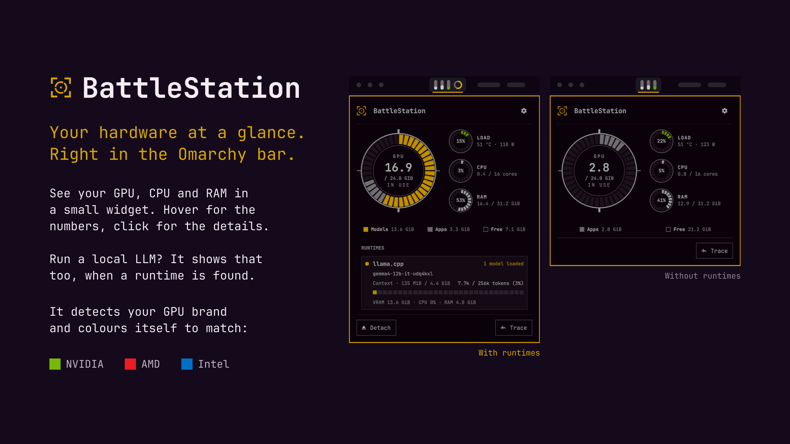
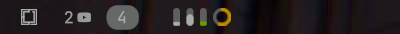
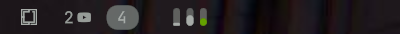
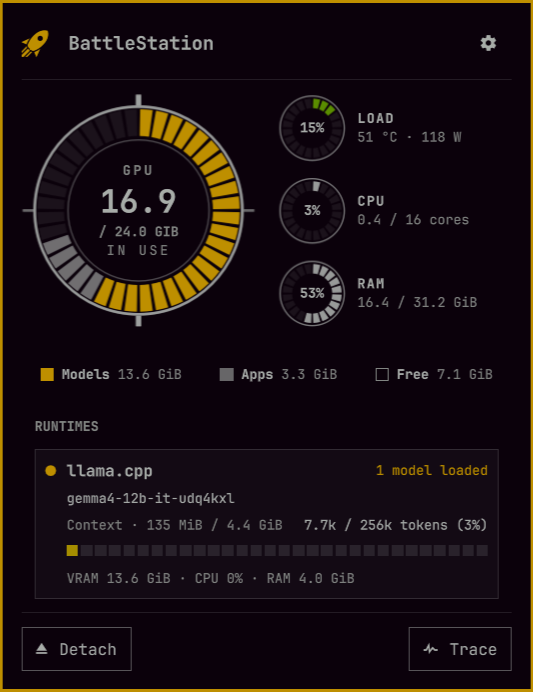
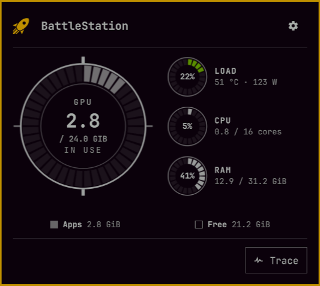
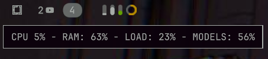
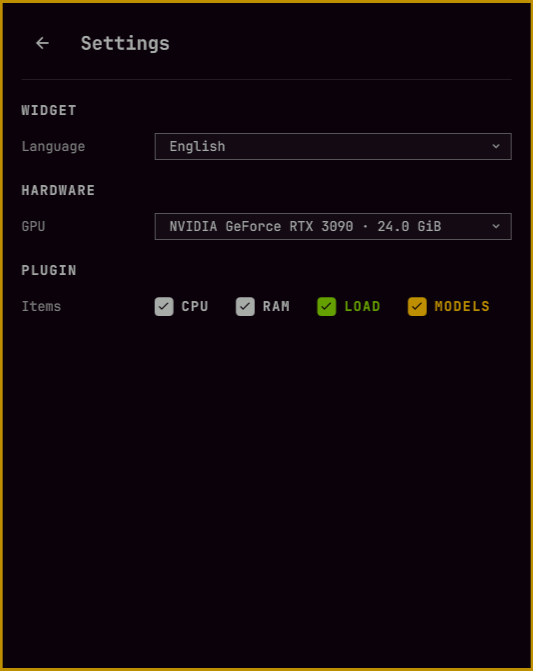

# BattleStation



**See your GPU, CPU and RAM at a glance, right in the Omarchy bar, and what your local LLM is doing to them.**

BattleStation is a small Omarchy bar widget that monitors your hardware. If you run local models with **llama.cpp**, **Ollama**, **LM Studio** or **vLLM**, it also shows how much GPU memory they hold and how full their context is.

## Install

Requires Omarchy Quattro on x86_64. Nothing needs to be compiled: the engine ships prebuilt.

```sh
omarchy plugin add https://github.com/vk2r/battle-station
omarchy plugin enable io.github.vk2r.battle-station
```

### Requirements

- **Omarchy Quattro** with its plugin-capable Quickshell, on **x86_64**.
- **A GPU driver for your card:**
  - **NVIDIA:** the proprietary driver, which provides `libnvidia-ml.so`.
  - **AMD:** `libdrm`, which is part of a standard Omarchy install.
  - **Intel (Arc / Iris Xe):** the `i915` or `xe` kernel driver.

  Without a supported GPU, the CPU, RAM and runtime information still works.
- **`btop`**, for the **Trace** button and the right click.
- **`curl`, `jq` and systemd** (user session), used by **Detach**. They are normally already present on Omarchy.
- **Optional, only if you use them:**
  - A local LLM runtime: **llama.cpp**, **Ollama**, **LM Studio** or **vLLM**. The runtimes section shows only the ones found on your machine.
  - **`llama-fit-params`**, shipped with llama.cpp next to `llama-server`, to estimate the context memory of a llama.cpp model.
  - **LM Studio's `lms` command**, for **Detach** to unload LM Studio models.

## How it works internally

```
/proc · GPU (all-smi) · runtimes' local APIs ──► engine (Rust) ──► EngineHub.qml ──► bar widget + panel
                                                  one JSON snapshot every 2 s
```

- **A small engine does the reading.** `bin/engine` (Rust, source in `engine/`) runs while the widget is loaded and prints one JSON snapshot every two seconds. It uses under 1% of one CPU core and about 30 MiB of RAM.
- **One engine, many views.** `EngineHub.qml` runs a single engine process and shares its snapshots with every bar widget and the panel. This matters with several monitors, where Omarchy builds one bar per screen: they all read the same engine instead of each starting its own.
- **Hardware comes from the system.** CPU and RAM are read from `/proc`. GPU memory, load, temperature and power come from [all-smi](https://github.com/lablup/all-smi), which also tells the brand of the card.
- **Runtimes are asked only when they are already running.** The engine queries their local status endpoints on `127.0.0.1` (llama.cpp 8080, Ollama 11434, LM Studio 1234, vLLM 8000) and tells them apart by their systemd unit and executable path. It never starts, stops or reconfigures a runtime, and sends nothing over the network.
- **GPU memory per runtime** is taken from the GPU's per-process memory, so the bar can show how much VRAM the models hold, separate from the other apps.
- **The interface only draws.** The bar widget and the panel are QML; they show whatever the latest snapshot says, and the only action that changes anything is **Detach**.

The bundled binaries are built by GitHub Actions and carry a build provenance attestation, so you can check that they come from this source (`gh attestation verify bin/engine --repo vk2r/battle-station`). More details, including how to rebuild the engine, are in [DEVELOPMENT.md](DEVELOPMENT.md).

## Usage

The widget lives in the bar and opens a panel with a click. It looks different depending on whether it finds a local LLM runtime on your machine:

<table>
  <tr>
    <th align="center">With runtimes</th>
    <th align="center">Without runtimes</th>
  </tr>
  <tr>
    <td align="center" valign="top"></td>
    <td align="center" valign="top"></td>
  </tr>
  <tr>
    <td align="center" valign="top"></td>
    <td align="center" valign="top"></td>
  </tr>
</table>

- **Left click** opens the panel.
- **Right click** opens btop.

### The bar

Three level meters show **CPU**, **RAM** and **GPU load**. A ring appears only while a model is loaded and shows the GPU memory the models hold. The meters pulse while the GPU is generating.

Hover the widget to see the figures behind the meters:



The tooltip also shows the generation speed of the loaded model (tokens per second, live and average) on llama.cpp with `--metrics`, and on vLLM.

### GPU colour

The brand of your GPU is detected automatically and the plugin is coloured to match: the **GPU load** meter, in the bar and in the panel, is green for NVIDIA, red for AMD and blue for Intel. With another card it keeps the default colour.

### The panel

- **GPU memory** as a ring, split into _Models_, _Apps_ and _Free_.
- **Load**, **CPU** and **RAM** rings, with temperature and power for the GPU.
- **Runtimes:** llama.cpp, Ollama, LM Studio and vLLM, only the ones found on your machine. A running one gets its own card with its state, model, context and output fill, VRAM, CPU and RAM. With no runtime installed, the section is hidden.
- **Context and output bars** turn green, yellow, orange and red as they fill up (50%, 75% and 90%).
- **Detach** frees the GPU memory by unloading every loaded model. Ollama, LM Studio and the llama.cpp router keep running and load a model again on the next request. A `llama-server` without the router, or vLLM, cannot unload a model, so its user systemd service is stopped instead.
- **Trace** opens btop.

The plugin only reads information. It never starts, stops or changes a runtime unless you click **Detach**.

### Settings



Open them with the gear (⚙) at the top right of the panel; **← Back**, Backspace or Esc closes them.

- **Language:** English, German, French, Spanish, Italian, Portuguese, Dutch or Polish. By default it follows your keyboard layout, then your system locale.
- **GPU:** the card to follow, if you have more than one. By default, the one with the most memory.
- **Items:** choose which meters the bar shows: CPU, RAM, LOAD and MODELS.

## Update or remove

```sh
omarchy plugin update io.github.vk2r.battle-station
```

```sh
omarchy plugin disable io.github.vk2r.battle-station
omarchy plugin remove io.github.vk2r.battle-station
```

The plugin creates no files or services outside its own folder, so nothing else needs cleaning up.

## Acknowledgements

Thanks to [LLM Monitor](https://github.com/uBruckhaus/omarchy-llm-usage) for the project structure and some of the components BattleStation is built on.

## License

[MIT](LICENSE). The bundled engine includes [all-smi](https://github.com/lablup/all-smi) under the [Apache License 2.0](licenses/all-smi-Apache-2.0.txt); see [`licenses/THIRD-PARTY.txt`](licenses/THIRD-PARTY.txt) for the rest.
